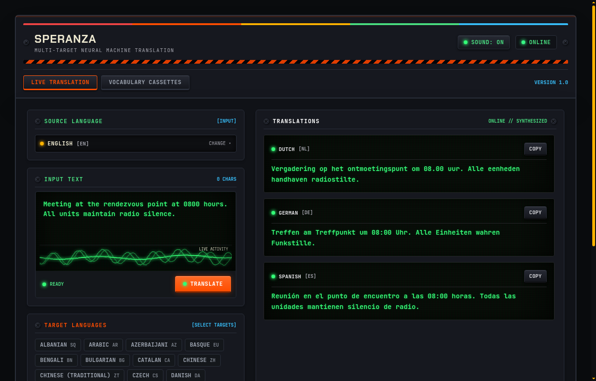
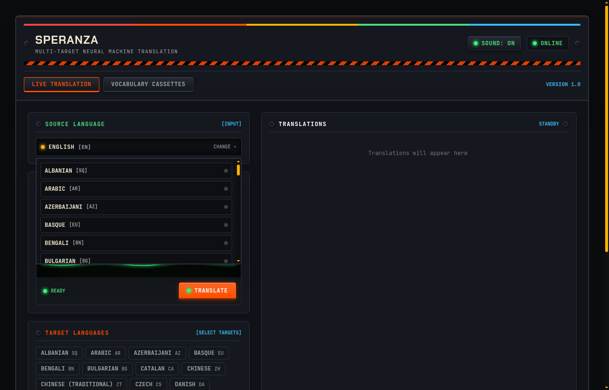
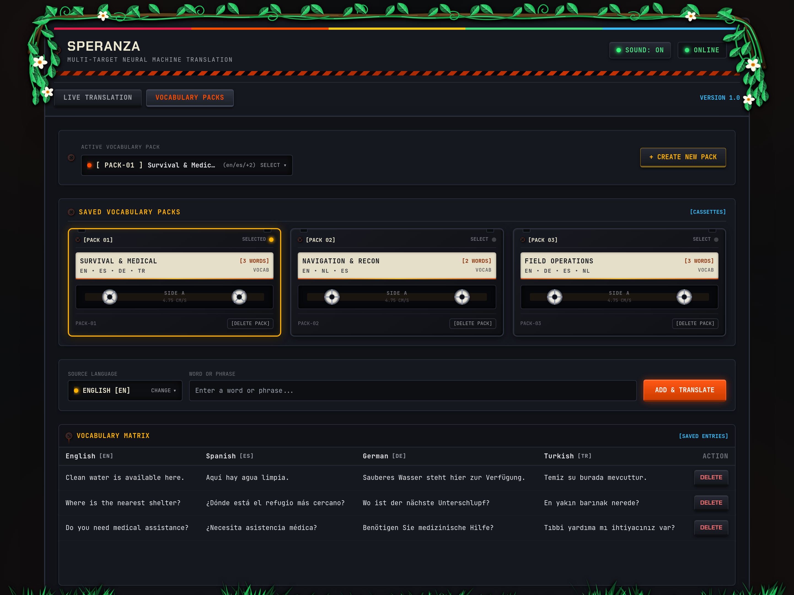
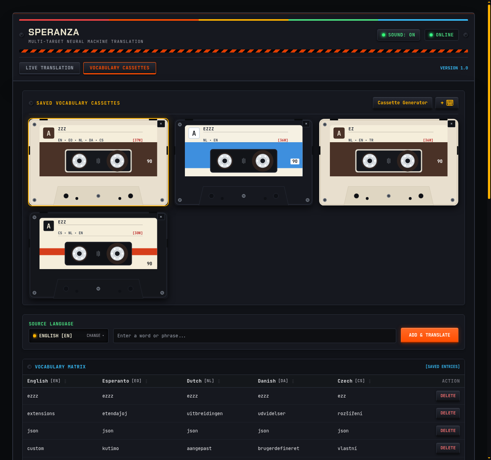
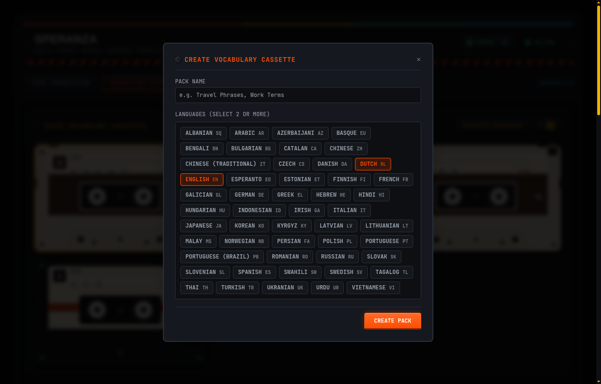

[](https://podman.io/)
[](https://www.docker.com/)
[](https://fastapi.tiangolo.com/)
[](https://www.python.org/)
[-FF6B33)](https://www.argosopentech.com/)
[](LICENSE)

---

## What is this project?

**Speranza** is a private, self-hosted web app that translates text into multiple languages at the same time and lets you manage shared vocabulary lists.

Unlike Google Translate, DeepL, or cloud translation services:
- **It runs 100% locally on your own machine.** No text is ever sent over the internet or logged by third parties.
- **No API keys, accounts, or subscriptions required.**
- **CPU-friendly:** Neural translation runs locally via [Argos Translate](https://www.argosopentech.com/) (OpenNMT / CTranslate2), requiring no GPU.
- **Smart English Pivot:** To translate between languages without downloading hundreds of individual model pairs, it routes translations through English (`Source -> English -> Target Languages`).

---

## UI & Design Context

The interface is built as a love letter to **1970s and 1980s retro hardware and cassette-futurism** (inspired by retro sci-fi aesthetics and games like *ARC Raiders*).



---

## What can you do with it?

### 1. Multi-Target Live Translation
Type or paste text into the input terminal and select multiple destination languages (e.g., Dutch, Spanish, German, Turkish, French). Speranza translates into all selected languages simultaneously in real time.

<p align="center">
  
</p>

### 2. Vocabulary Packs
Create custom vocabulary lists such as travel phrases or study decks containing multiple languages.

<p align="center">
  
</p>

<p align="center">
  
</p>

### 3. Pack Creation & Custom Language Sets
Define custom packs configured with any combination of installed language models:

<p align="center">
  
</p>

---

## How to Run It

Speranza is fully containerized. You do **not** need Python, Node.js, or any compilers installed on your host system.

### Prerequisites
Install either:
- **[Podman](https://podman.io/)** (with `podman-compose`) — *recommended, especially on Linux/Fedora*
- **[Docker](https://www.docker.com/)** (with `docker compose`)

### Option A: Using Podman (Rootless)

```bash
# 1. Clone the repo
git clone https://github.com/AliAydinlioglu/Speranza.git
cd Speranza

# 2. Build and start the container in the background
podman compose up -d --build

# 3. View live logs
podman compose logs -f

# 4. Stop the container
podman compose down
```

### Option B: Using Docker

```bash
# 1. Clone the repo
git clone https://github.com/AliAydinlioglu/Speranza.git
cd Speranza

# 2. Build and start
docker compose up -d --build

# 3. View live logs
docker compose logs -f

# 4. Stop the container
docker compose down
```

### Accessing the Web App
Once the container starts, open your browser and go to:
**[http://localhost:8000](http://localhost:8000)**

You can also check the health endpoint:
```bash
curl http://localhost:8000/health
# {"status":"healthy"}
```

---

## Data Persistence & Volumes

Everything you create is saved across container restarts using two named volumes defined in `compose.yaml`:

| Volume Name | Container Path | What It Stores |
| :--- | :--- | :--- |
| `translator_db` | `/app/data` | SQLite database file (`bundles.db`) with your saved packs and vocabulary entries. |
| `translator_models` | `/home/appuser/.local/share/argos-translate` | Downloaded Argos Translate neural language packages so models don't re-download on every start. |

---

---

## Repository Structure

Speranza is structured into clear, decoupled backend and frontend domains:

```text
Speranza/
├── backend/
│   ├── app/
│   │   ├── api/
│   │   │   ├── router.py             # Main API router blueprint
│   │   │   └── routes/
│   │   │       ├── health.py         # System health endpoint
│   │   │       ├── languages.py      # Language model discovery & installation
│   │   │       ├── translate.py      # Real-time multi-target translation
│   │   │       ├── bundles.py        # Vocabulary pack CRUD & matrix
│   │   │       └── gdpr.py           # GDPR export, purge, & privacy policy
│   │   ├── core/
│   │   │   ├── config.py             # Settings & filesystem paths
│   │   │   └── models.py             # Pydantic data schemas
│   │   ├── engine/
│   │   │   ├── package_manager.py    # Argos package index & installation
│   │   │   └── translator.py         # Non-blocking neural translation & English pivot
│   │   ├── services/
│   │   │   └── gdpr_service.py       # GDPR export & erasure services
│   │   ├── storage/
│   │   │   ├── database.py           # SQLite connection with WAL mode
│   │   │   └── repository.py         # SQL CRUD repository & vacuum operations
│   │   └── main.py                   # FastAPI application initialization & lifespan
│   ├── tests/                        # Comprehensive test suite
│   └── requirements.txt              # Pinned backend dependencies
├── frontend/
│   ├── static/
│   │   ├── css/
│   │   │   ├── app.css               # Chassis styling & retro tokens
│   │   │   └── crt.css               # CRT scanlines & phosphor effects
│   │   ├── js/
│   │   │   ├── api.js                # Frontend API fetch client
│   │   │   ├── audio.js              # Web Audio mechanical synthesizer
│   │   │   ├── bundles.js            # Cassette deck matrix controller
│   │   │   ├── gdpr.js               # GDPR privacy, export & erasure controller
│   │   │   ├── oscilloscope.js       # Real-time CRT audio visualizer
│   │   │   └── translate.js          # Live translation controller
│   │   └── img/                      # SVG artwork and foliage overlays
│   └── templates/
│       └── index.html                # Terminal user interface
├── compose.yaml                      # Rootless container orchestration
├── Containerfile                     # OCI container build specification
└── requirements.txt                  # Compatibility requirements reference
```

---

## GDPR & Privacy by Design

Speranza strictly adheres to the EU General Data Protection Regulation (GDPR) 2016/679:

- **100% Offline Processing (Art. 25 Privacy by Design):** All neural translations run locally on your CPU. No translation text, metadata, or telemetry is ever sent over the network or logged to external servers.
- **Data Minimization (Art. 5(1)(c)):** Live translation inputs are strictly ephemeral and processed in-memory only.
- **Right to Data Portability (Art. 20):** Download a complete, machine-readable JSON archive of all your saved packs, phrases, and translations via `GET /api/gdpr/export` or the in-app "EXPORT DATA (JSON)" button.
- **Right to Erasure (Art. 17 "Right to be Forgotten"):** Permanently erase all stored vocabulary packs and zero out the SQLite database via `POST /api/gdpr/erase` or the in-app "PURGE ALL DATA" button.
- **Zero Tracking / Zero Cookies:** No tracking cookies, advertising beacons, or third-party analytics are used.

---

## Tech Stack

- **Backend**: Python 3.11, [FastAPI](https://fastapi.tiangolo.com/), Uvicorn (running under a non-root `appuser`).
- **Storage**: SQLite 3 with WAL (Write-Ahead Logging) mode enabled for safe concurrent access.
- **Translation Engine**: [Argos Translate](https://github.com/argosopentech/argos-translate) wrapped in non-blocking worker threads (`asyncio.to_thread`).
- **Frontend**: Jinja2 HTML templates, Tailwind CSS, Vanilla JavaScript (ES6 modules, zero build step, no npm dependencies).
- **Audio & Visuals**: Native HTML5 Canvas 2D and Web Audio API.

---

## REST API Overview

In addition to the web UI, Speranza exposes a clean REST API under `/api`:

### System
- `GET /health` — Check if the service is up.

### GDPR & Privacy
- `GET /api/gdpr/policy` — Retrieve the privacy statement and data rights declaration.
- `GET /api/gdpr/export` — Export all user data (bundles, entries, translations) in portable JSON format (GDPR Art. 20).
- `POST /api/gdpr/erase` — Permanently purge all user data from database and vacuum disk space (GDPR Art. 17).

### Languages
- `GET /api/languages` — List available languages and check whether their model packages are downloaded.
- `POST /api/languages/install` — Trigger installation of a language model pair.
  ```json
  { "from_code": "en", "to_code": "nl" }
  ```

### Translation
- `POST /api/translate` — Translate text to multiple languages.
  ```json
  {
    "text": "Meeting at the rendezvous point.",
    "source_lang": "en",
    "target_langs": ["nl", "de", "es"]
  }
  ```
  Response:
  ```json
  {
    "translations": {
      "nl": "Vergadering op het ontmoetingspunt.",
      "de": "Treffen am Treffpunkt.",
      "es": "Reunión en el punto de encuentro."
    }
  }
  ```

### Vocabulary Packs
- `GET /api/bundles` — List all vocabulary packs and their language codes.
- `POST /api/bundles` — Create a new pack:
  ```json
  {
    "name": "Travel Basics",
    "languages": ["en", "es", "it"]
  }
  ```
- `GET /api/bundles/{id}` — Get the full matrix of phrases and translations for a pack.
- `POST /api/bundles/{id}/entries` — Add a word/sentence to a pack; auto-translates to all other languages in that pack:
  ```json
  {
    "source_lang": "en",
    "text": "Where is the train station?"
  }
  ```
- `DELETE /api/bundles/{id}/entries/{entry_id}` — Delete an entry.
- `DELETE /api/bundles/{id}` — Delete an entire pack.

---

## License

MIT License. See [LICENSE](LICENSE) for details.

