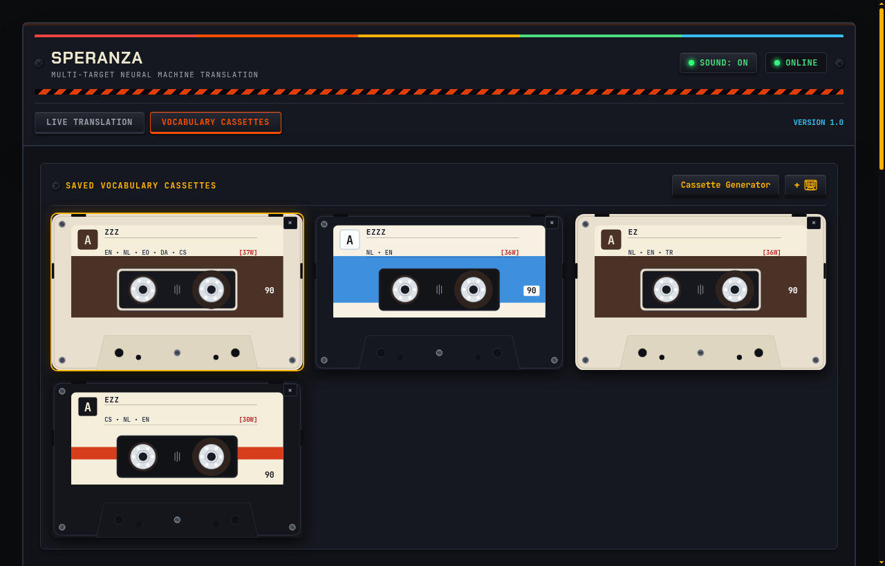
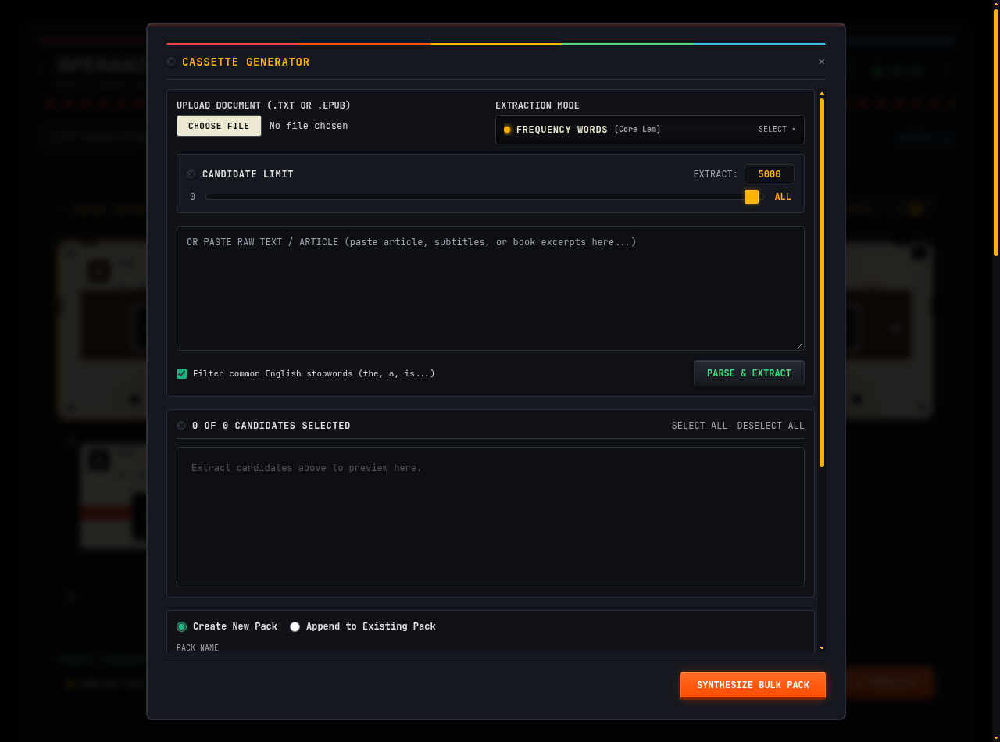
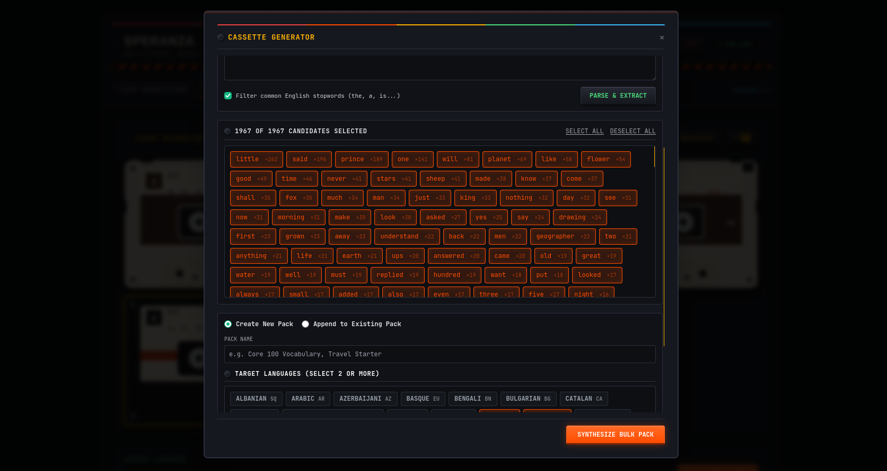

# Speranza

[](https://github.com/AliAydinlioglu/Speranza/releases/tag/v1.0.0)
[](https://podman.io/)
[](https://www.docker.com/)
[](https://fastapi.tiangolo.com/)
[](https://www.python.org/)
[-FF6B33)](https://www.argosopentech.com/)
[-blue.svg)](LICENSE)

> **Private, offline multi-target neural translation and vocabulary cassette studio.**

---

## What is this project?

**Speranza** is a private, self-hosted web app that translates text into multiple languages simultaneously and manages interactive multi-language vocabulary cassettes.

Unlike Google Translate, DeepL, or cloud translation services:
- **100% Offline & Local:** Runs completely on your own machine. No text is ever sent over the internet or logged by third parties.
- **No API Keys or Accounts:** Zero subscriptions, credentials, or telemetry.
- **CPU-Friendly Neural Engine:** Neural translation runs locally via [Argos Translate](https://www.argosopentech.com/) (OpenNMT / CTranslate2), requiring no GPU.
- **Smart English Pivot:** Translates between arbitrary language pairs by routing through English (`Source -> English -> Target Languages`) without downloading hundreds of permutations.

---

## UI & Design Context

The interface is built as a tribute to **1970s and 1980s retro hardware, industrial computing, and cassette-futurism**.


---

## Features

### 1. Multi-Target Live Translation
Speranza translates into all selected languages simultaneously in real time.

<p align="center">
  
</p>

### 2. Vocabulary Cassettes
Organize custom vocabulary cassettes.

<p align="center">
  
</p>

<p align="center">
  
</p>

### 3. Cassette Creation & Language Sets
Define custom vocabulary cassettes configured with any combination of installed language models:

<p align="center">
  
</p>

### 4. Cassette Generator (Corpus & Book Importer)
Import complete books or articles (`.txt`, `.epub`) or paste raw text. Extract high-frequency vocabulary lemmas with an uncapped limit slider (0 to 5000+ / ALL), preview candidate words, and synthesize new vocabulary cassettes or append to existing ones.

<p align="center">
  
</p>
<p align="center">
  
</p>

---

## How to Run It

Speranza is fully containerized. You do **not** need Python, Node.js, or any compilers installed on your host system.

### Prerequisites
Install either:
- **[Podman](https://podman.io/)** (with `podman-compose`) — *recommended, especially on Linux/Fedora*
- **[Docker](https://www.docker.com/)** (with `docker compose`)

### Option A: Using Podman (Rootless)

```bash
# 1. Clone the repo
git clone https://github.com/AliAydinlioglu/Speranza.git
cd Speranza

# 2. Build and start the container in the background
podman compose up -d --build

# 3. View live logs
podman compose logs -f

# 4. Stop the container
podman compose down
```

### Option B: Using Docker

```bash
# 1. Clone the repo
git clone https://github.com/AliAydinlioglu/Speranza.git
cd Speranza

# 2. Build and start
docker compose up -d --build

# 3. View live logs
docker compose logs -f

# 4. Stop the container
docker compose down
```

### Accessing the Web App
Once the container starts, open your browser and go to:
**[http://localhost:8000](http://localhost:8000)**

You can also check the system health endpoint:
```bash
curl http://localhost:8000/health
# {"status":"healthy"}
```

---

## Data Persistence & Volumes

Everything you create is saved across container restarts using two named volumes defined in `compose.yaml`:

| Volume Name | Container Path | What It Stores |
| :--- | :--- | :--- |
| `translator_db` | `/app/data` | SQLite database file (`bundles.db`) with your saved cassettes, phrases, and translations. |
| `translator_models` | `/home/appuser/.local/share/argos-translate` | Downloaded Argos Translate neural language packages so models persist across container restarts. |

---

## Privacy by Design

- **100% Offline Processing:** All neural translations run locally on your CPU. No translation text, metadata, or telemetry is ever sent over the network or logged to external servers.
- **Data Minimization:** Live translation inputs are strictly ephemeral and processed in-memory only.
- **Zero Tracking:** No cookies, analytics beacons, or third-party tracking scripts.

---

## Tech Stack

- **Backend**: Python 3.11, [FastAPI](https://fastapi.tiangolo.com/), Uvicorn (running under a non-root `appuser`).
- **Storage**: SQLite 3 with WAL (Write-Ahead Logging) mode enabled for safe concurrent access.
- **Translation Engine**: [Argos Translate](https://github.com/argosopentech/argos-translate) wrapped in non-blocking worker threads (`asyncio.to_thread`).
- **Corpus Processing**: [wordfreq](https://github.com/rspeer/wordfreq) for multilingual Zipf frequency extraction.
- **Frontend**: Jinja2 HTML templates, Tailwind CSS with centralized theme variables (`theme.css`), Vanilla JavaScript (ES6 modules, zero build step, no npm dependencies).
- **Audio & Visuals**: Native HTML5 Canvas 2D and Web Audio API.

---

## REST API Overview

In addition to the web UI, Speranza exposes a clean REST API under `/api`:

### System
- `GET /health` — System health check.

### Languages
- `GET /api/languages` — List available languages and check whether their neural models are downloaded.
- `POST /api/languages/install` — Trigger installation of a language model pair.
  ```json
  { "from_code": "en", "to_code": "nl" }
  ```

### Translation
- `POST /api/translate` — Translate text to multiple target languages simultaneously.
  ```json
  {
    "text": "Meeting at the rendezvous point.",
    "source_lang": "en",
    "target_langs": ["nl", "de", "es"]
  }
  ```
  Response:
  ```json
  {
    "translations": {
      "nl": "Vergadering op het ontmoetingspunt.",
      "de": "Treffen am Treffpunkt.",
      "es": "Reunión en el punto de encuentro."
    }
  }
  ```

### Vocabulary Cassettes
- `GET /api/bundles` — List all vocabulary cassettes and their language codes.
- `POST /api/bundles` — Create a new cassette.
- `GET /api/bundles/{id}` — Get the full matrix of phrases and translations for a cassette.
- `POST /api/bundles/{id}/entries` — Add a word/sentence to a cassette; auto-translates to all cassette languages.
- `DELETE /api/bundles/{id}/entries/{entry_id}` — Delete an entry.
- `DELETE /api/bundles/{id}` — Delete an entire cassette.

### Cassette Generator & Corpus
- `POST /api/corpus/analyze/text` — Extract candidate vocabulary from raw text with frequency thresholding.
- `POST /api/corpus/analyze/file` — Upload a document (`.txt` or `.epub`) and extract top candidate words.
- `POST /api/corpus/extract/batch` — Initiate asynchronous batch translation and cassette synthesis.
- `GET /api/corpus/tasks/{task_id}` — Poll real-time progress and telemetry for a batch generation task.

---

## License

Modified MIT License (No-Sale Clause). See [LICENSE](LICENSE) for details.
